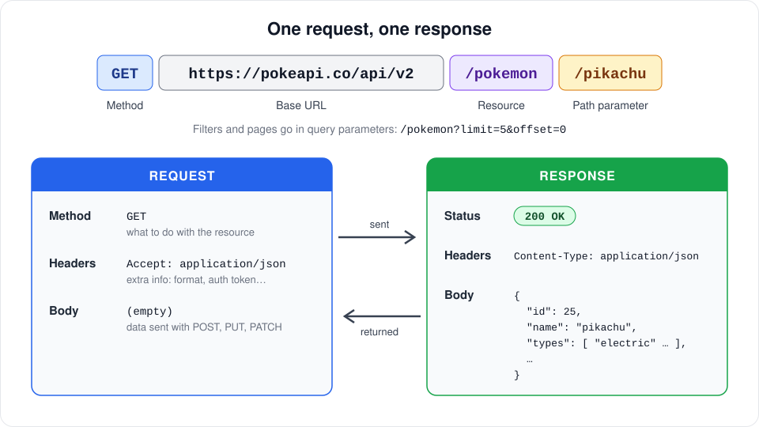
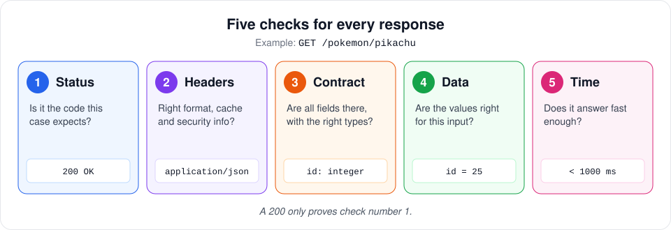
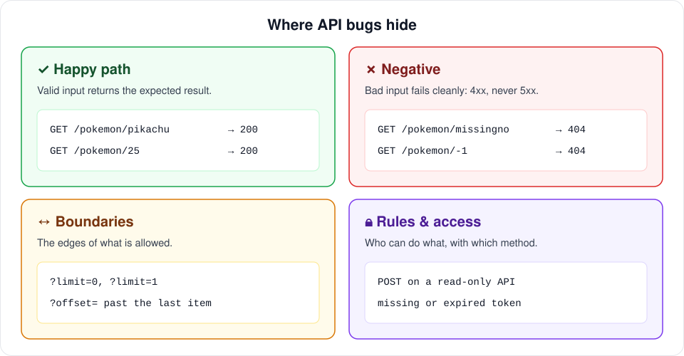
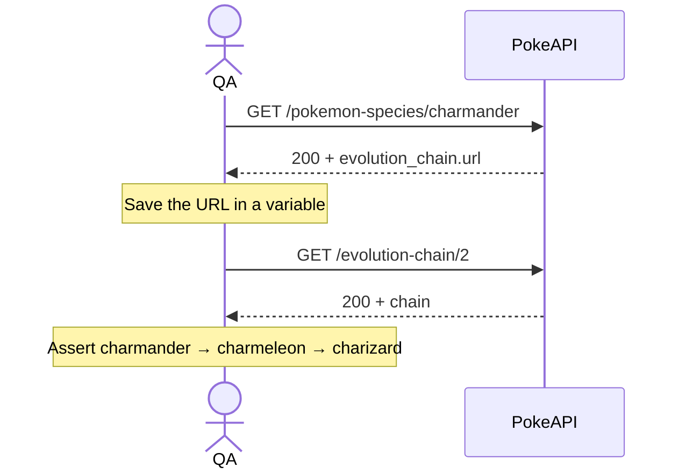
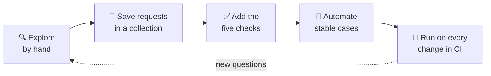

# 🔌 API Testing Guide: From First Request to Automated Suite
### *A Simple, Robust Method for Testing REST APIs, with Every Example Runnable*

Most API bugs are invisible from the UI until a user hits them: a field that comes back empty, an error that returns `500` instead of `400`, a response that slowly gets heavier with every release. This guide gives you a small, repeatable method to catch them, whether you test by hand in Postman or with an automated suite.

Every example uses [PokeAPI](https://pokeapi.co), a free public API that needs no account or token, so you can try each step as you read.

> [!TIP]
> **Try it right now:** open [https://pokeapi.co/api/v2/pokemon/pikachu](https://pokeapi.co/api/v2/pokemon/pikachu) in your browser. What you see is a real API response, and by the end of this guide you will know how to test it.

---

## 🧭 Contents

1. [Anatomy of a Request and a Response](#-1-anatomy-of-a-request-and-a-response)
2. [The Five Checks for Every Response](#-2-the-five-checks-for-every-response)
3. [Status Codes Cheat Sheet](#-3-status-codes-cheat-sheet)
4. [Designing Test Cases](#-4-designing-test-cases)
5. [Manual Testing with Postman](#-5-manual-testing-with-postman)
6. [Contract Testing with JSON Schema](#-6-contract-testing-with-json-schema)
7. [Chained Requests](#-7-chained-requests)
8. [From Manual to Automated](#-8-from-manual-to-automated)
9. [Writing an API Bug Report](#-9-writing-an-api-bug-report)
10. [Common Anti-Patterns](#-10-common-anti-patterns)
11. [Practice Exercises](#-11-practice-exercises)

---

## 📨 1. Anatomy of a Request and a Response

Every API test is a conversation with two messages: the request you send and the response you get back. Before testing anything, learn to read both.



| Part | What it is | Example |
| :--- | :--- | :--- |
| **Method** | The action you want to perform. | `GET` |
| **Base URL** | Where the API lives. It changes between environments (dev, staging, prod). | `https://pokeapi.co/api/v2` |
| **Resource** | The kind of thing you are asking for. | `/pokemon` |
| **Path parameter** | Which specific item. | `/pikachu` or `/25` |
| **Query parameters** | Filters, sorting and pagination. | `?limit=5&offset=0` |
| **Headers** | Extra information about the message: format, language, authentication. | `Accept: application/json` |
| **Body** | Data you send (requests) or receive (responses), usually JSON. | `{ "name": "pikachu" }` |
| **Status code** | A three-digit summary of what happened. | `200 OK` |

### The methods you will meet most

| Method | Purpose | What to test beyond the happy path |
| :--- | :--- | :--- |
| `GET` | Read data. | Nothing changes on the server, no matter how many times you call it. |
| `POST` | Create something new. | Duplicates, missing required fields, the created item can be read back. |
| `PUT` | Replace an item completely. | Fields you leave out are cleared or rejected, as the docs promise. |
| `PATCH` | Change some fields. | Only the fields you sent change; the rest stay intact. |
| `DELETE` | Remove an item. | A second delete and a later `GET` behave as documented (usually `404`). |

> [!NOTE]
> PokeAPI is read-only, so it only accepts `GET`. The other methods matter in almost any real project, and the same five checks below apply to all of them.

---

## ✅ 2. The Five Checks for Every Response

A `200 OK` means the server did not complain. It doesn't tell you whether the data is right, complete or fast. Run these five checks on every response you test:



| # | Check | Question it answers | Example for `GET /pokemon/pikachu` |
| :---: | :--- | :--- | :--- |
| 1 | **Status** | Is it the code this specific case expects? | `200` |
| 2 | **Headers** | Is the format right? Are cache and security headers present? | `Content-Type: application/json` |
| 3 | **Contract** | Are all fields there, with the right types? | `id` is an integer, `types` is a list |
| 4 | **Data** | Are the values correct for this input? | `id` is `25`, the type is `electric` |
| 5 | **Time** | Does it answer within the agreed limit? | Under 1000 ms |

The order matters when something fails: if the status is wrong, the rest of the checks usually fail as a consequence, so report the first broken check and mention the others as side effects.

---

## 🔢 3. Status Codes Cheat Sheet

The first digit tells you who is responsible: `2xx` it worked, `4xx` the client sent something wrong, `5xx` the server broke.

| Code | Meaning | When you should see it | 🚩 Bug smell |
| :--- | :--- | :--- | :--- |
| `200` | OK | A successful read or update. | An error message inside a `200` body. |
| `201` | Created | A `POST` that created something. | `200` with no way to find the new item. |
| `204` | No Content | A successful delete or update with nothing to return. | A `204` that actually returns a body. |
| `400` | Bad Request | Malformed or invalid input. | A generic message that doesn't say which field failed. |
| `401` | Unauthorized | Missing or invalid credentials. | Data returned without a token. |
| `403` | Forbidden | Valid user, but not allowed to do this. | A regular user can reach admin data. |
| `404` | Not Found | The item doesn't exist. | `500` for an ID that doesn't exist. |
| `405` | Method Not Allowed | The resource exists but not with that method. | A read-only endpoint that accepts `DELETE`. |
| `409` | Conflict | Duplicates or a state that doesn't allow the action. | Two items created with the same unique value. |
| `422` | Unprocessable Entity | Valid format, but it breaks a business rule. | The rule is silently ignored. |
| `429` | Too Many Requests | You hit the rate limit. | No limit at all on login attempts. |
| `500` | Internal Server Error | Something broke on the server. | **Any** `500` caused by user input is a bug. |
| `503` | Service Unavailable | The service is down or overloaded. | Frequent `503` under normal load. |

> [!IMPORTANT]
> **The golden rule of negative testing:** bad input must fail with a clear `4xx`. A `5xx` caused by anything the user sent means the server didn't validate it, and that is always worth a bug report.

---

## 🧪 4. Designing Test Cases

Testing only the happy path covers a quarter of the map. Spread your cases across all four areas:



### ✓ Happy path
The documented, expected use. Test each way of identifying an item: by name **and** by id should return the same Pokémon.

### ✗ Negative
Inputs the API must reject cleanly. Good candidates for any parameter:
* A value that doesn't exist: `/pokemon/missingno-2026`
* A wrong type: letters where a number is expected, a number where text is expected.
* Negative numbers, zero, decimals: `/pokemon/-1`, `/pokemon/0`, `/pokemon/1.5`
* Empty values, spaces, very long strings, special characters and emojis.
* Different casing: does `/pokemon/PIKACHU` behave like `/pokemon/pikachu`? Whatever the answer, it should be documented and consistent.

### ↔ Boundaries
Bugs cluster at the edges. For a pagination parameter like `limit`, apply **boundary value analysis**: test just below, on and just above each edge.

| Input | Why it's interesting |
| :--- | :--- |
| `?limit=0` | The lower edge. An empty list, an error or the default page? |
| `?limit=1` | The smallest valid page. |
| `?limit=-1` | Below the edge. It should be rejected or ignored, never crash. |
| `?offset=` past the last item | Should return an empty list, not an error. |
| A huge `limit` | Is there a maximum? What happens above it? |

Write down what *should* happen before you send the request. If the documentation doesn't say, that gap is a finding in itself: ask, and get the answer added to the docs.

### 🔒 Rules & access
Who can do what, and with which method:
* A method the endpoint doesn't support (`POST` on a read-only API) should return `405`.
* No token, an expired token, a token from another user.
* A regular user trying an admin action, or reading another user's data by changing an id in the URL.

---

## 🧰 5. Manual Testing with Postman

[Postman](https://www.postman.com/downloads/) lets you send requests, save them and attach automatic checks to each one. A simple, solid setup:

1. **Create a collection** called `PokeAPI` to group every request.
2. **Create an environment** with a variable `baseUrl = https://pokeapi.co/api/v2`. Your requests use `{{baseUrl}}/pokemon/pikachu`, so switching from staging to production means changing a single value.
3. **Send the request** and read the five checks by eye.
4. **Turn what you checked into tests**, in the request's **Scripts → Post-response** tab:

```javascript
pm.test("1. Status is 200", () => {
    pm.response.to.have.status(200);
});

pm.test("2. Response is JSON", () => {
    pm.expect(pm.response.headers.get("Content-Type")).to.include("application/json");
});

pm.test("4. Returns Pikachu with the right data", () => {
    const pokemon = pm.response.json();
    pm.expect(pokemon.id).to.eql(25);
    pm.expect(pokemon.name).to.eql("pikachu");
    const types = pokemon.types.map(t => t.type.name);
    pm.expect(types).to.include("electric");
});

pm.test("5. Responds in under 1 second", () => {
    pm.expect(pm.response.responseTime).to.be.below(1000);
});
```

5. **Run the whole collection** with the Collection Runner. Every request and every check runs in one click, which is your first regression suite.

> [!TIP]
> **No Postman? Use curl.** `curl -i https://pokeapi.co/api/v2/pokemon/pikachu` prints the status line and headers before the body. It's the fastest way to attach a reproducible request to a bug report.

---

## 📜 6. Contract Testing with JSON Schema

Check 4 asks whether the values are right. Check 3 asks something different: is the *shape* of the response what consumers rely on? A [JSON Schema](https://json-schema.org/) describes that shape once, and every response gets validated against it.

```json
{
  "type": "object",
  "required": ["id", "name", "types"],
  "properties": {
    "id":   { "type": "integer", "minimum": 1 },
    "name": { "type": "string", "minLength": 1 },
    "types": {
      "type": "array",
      "minItems": 1,
      "items": {
        "type": "object",
        "required": ["slot", "type"]
      }
    }
  }
}
```

In Postman, paste it into a test:

```javascript
const schema = { /* the schema above */ };

pm.test("3. Response matches the contract", () => {
    pm.response.to.have.jsonSchema(schema);
});
```

A contract test catches the changes that break apps without breaking the status code: a renamed field, a number that becomes a string, a list that becomes `null`.

---

## 🔗 7. Chained Requests

Real flows use the output of one request as the input of the next. In PokeAPI, a species points to its evolution chain through a URL:



In Postman, the first request saves the value for the second one:

```javascript
// Post-response script of: GET {{baseUrl}}/pokemon-species/charmander
const species = pm.response.json();
pm.collectionVariables.set("chainUrl", species.evolution_chain.url);
```

The second request simply uses `{{chainUrl}}` as its URL. This is how you test flows such as *create an order → pay it → check its status*, where each step depends on the previous answer.

---

## 🤖 8. From Manual to Automated

Automation works best on cases you have already explored by hand and understand well. A practical path:



| Automate | Keep manual (exploratory) |
| :--- | :--- |
| Checks you repeat every release (regression). | New features you are still learning. |
| Contracts and status codes. | Odd combinations and "what if…" ideas. |
| Smoke tests after each deploy. | Usability of error messages for people. |

### A real example

The [**PokeAPI QA Automation**](https://github.com/anagonzalezlame/pokeapi-qa-automation) project applies this guide end to end: the same five checks, the negative and boundary cases and the chained request above, written as BDD scenarios and run on GitHub Actions. This is one of its scenarios:

```gherkin
@api @negative
Scenario Outline: Requesting a Pokemon that does not exist returns 404
  When I request the pokemon "<value>"
  Then the response status code should be 404

  Examples:
    | value          | case            |
    | missingno-2026 | unknown name    |
    | 99999          | id out of range |
    | -1             | negative id     |
```

---

## 🐞 9. Writing an API Bug Report

An API bug report should let a developer reproduce the problem in under a minute, without asking you anything. Copy this template:

```markdown
**Title:** GET /pokemon/{id} returns 500 for a decimal id (expected 400 or 404)

**Environment:** Staging, https://staging.example.com/api/v2, build 1.42.0

**Request:**
curl -i "https://staging.example.com/api/v2/pokemon/1.5"

**Expected:** 4xx with a message explaining the id must be an integer.
**Actual:** 500 Internal Server Error, body: { "error": "unexpected" }

**Check that failed:** 1. Status
**Frequency:** 5 of 5 attempts
**Evidence:** full response attached, server request id: 7f3a…
**Impact:** any client sending a malformed id triggers a server error and an alert.
```

> [!TIP]
> Always include the exact request as `curl`. It removes every doubt about headers, parameters and environment, and a developer can paste it straight into a terminal.

---

## 🚫 10. Common Anti-Patterns

| Anti-Pattern | Why It Hurts | Fix |
| :--- | :--- | :--- |
| Only checking the status code | A `200` with wrong or missing data passes as green. | Apply all five checks. |
| Only testing the happy path | Most production bugs come from inputs nobody tried. | Cover the four areas of the test case map. |
| Hardcoding data that changes | Tests fail when data grows, not when the API breaks. | Assert stable facts and use ranges (`count > 1000`). |
| Hardcoding the environment URL | Moving to another environment means editing every request. | Keep the base URL in one variable. |
| Ignoring response time | Slow degradation goes unnoticed until users complain. | Agree on a limit and check it in every run. |
| Load or write tests against public or production APIs | You can harm a service or real data. | Use your own test environment and respect each API's fair use policy. |

---

## 📝 11. Practice Exercises

Use your browser, curl or Postman. Try each one before opening the answer.

**1.** What is the id of `ditto`?
<details><summary>Answer</summary>

`132`. Request: `GET /pokemon/ditto`, then read the `id` field.
</details>

**2.** Pikachu has two abilities. Which one is hidden?
<details><summary>Answer</summary>

`lightning-rod`. In `GET /pokemon/pikachu`, look inside `abilities` for the item with `"is_hidden": true`. The other ability, `static`, is not hidden.
</details>

**3.** Which types deal double damage to the Fire type?
<details><summary>Answer</summary>

`water`, `ground` and `rock`. Request `GET /type/fire` and read `damage_relations.double_damage_from`.
</details>

**4.** Request the second page of Pokémon with 5 per page. Which Pokémon comes first?
<details><summary>Answer</summary>

`charizard`. Request: `GET /pokemon?limit=5&offset=5`. The first page (offset 0) holds Pokémon 1 to 5, so the second page starts at number 6.
</details>

**5.** Follow Squirtle's evolution chain. What are its stages?
<details><summary>Answer</summary>

`squirtle > wartortle > blastoise`. First `GET /pokemon-species/squirtle`, then open the URL in `evolution_chain.url`.
</details>

**6.** What status code do you get for `/pokemon/missingno-2026`? Is that the right one?
<details><summary>Answer</summary>

`404 Not Found`. It's correct: the request is well formed and the item doesn't exist. A `500` here would be a bug.
</details>

---

## 🎓 About the Lead

I am **Ana González Lamé**, a Senior QA professional specializing in manual, exploratory and API testing within agile teams.
* **ISTQB® Certified Tester** (Foundation Level) & Professional Testing Master.
* **Women Techmakers Ambassador** & TestingUY community collaborator.
* **C2 Proficiency** in English.

---
*Every response tells you more than its status code. Testing an API means asking for the rest.*
[www.anagonzalez.uy](http://www.anagonzalez.uy)
